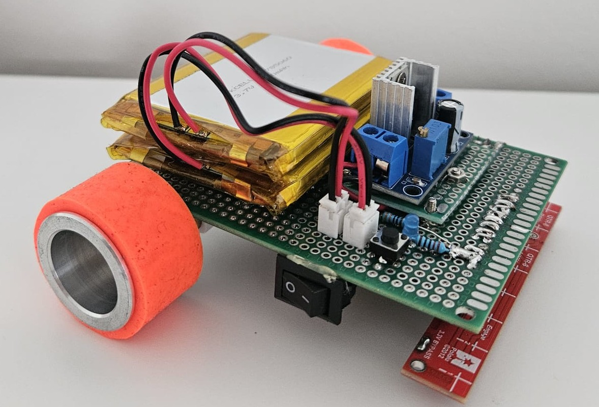

# LineFollower

  
## specifications

**microcontroller:** Arduino Nano ESP32

**motors:** Aslong JGA12-N20-30 DC-Transmissiemotor 6V - 500RPM

**h-bridge:** DRV8833

**sensors:** Pololu QTR-8A

**batteries:** Li-Po Batterij 3.7V 2500mAh

**wireless communication:** Wifi

**distance sensor - motors:** 7cm

**weight: **

**speed: **

